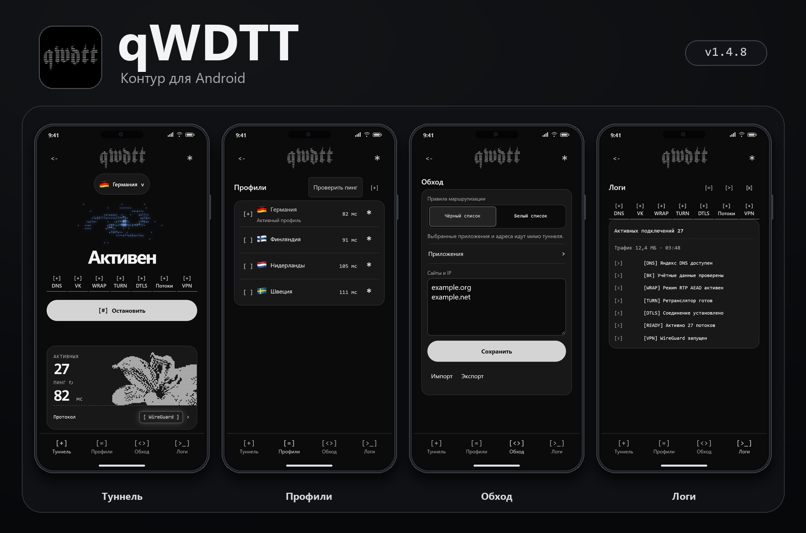

# qWDTT - Contur



VPN-клиент для Android с сервером для Linux. Поддерживает WireGuard, Raw TUN и локальный SOCKS5 через TURN.

[Скачать APK](https://github.com/konchul/proxy-turn-vk-android/releases/latest) · [Развернуть на ноде](#развёртывание-на-ноде) · [Оптимизации](#оптимизации)

## Android

Установите универсальный APK на Android 9 или новее. Добавьте профиль с доменом или IP своего сервера, паролем и данными для TURN. Выберите протокол и нажмите «Подключить».

В интерфейсе «Контур» видны этапы подключения, активные потоки и пинг. Нажатие на пинг повторяет замер по открытому туннелю.

## Развёртывание на ноде

Для новой ноды нужен Linux x86-64 с systemd, `/dev/net/tun`, `curl`, `openssl`, `ip` и `iptables`. Скачайте и просмотрите [скрипт установки](install.sh), затем запустите его.

```bash
curl -fsSLo install.sh https://raw.githubusercontent.com/konchul/proxy-turn-vk-android/master/install.sh
sudo bash install.sh
systemctl is-active wdtt
```

Скрипт выводит пароль для профиля и сохраняет его в `/etc/wdtt/main.password`. На действующей ноде перед запуском сохраните `/etc/wdtt`, серверный бинарник и файл службы `wdtt.service`.

| Режим | Входящий порт на ноде |
| --- | --- |
| WireGuard через DTLS | `56000/udp` |
| WireGuard Direct | `56002/udp` |
| Raw TUN (ChaCha20) | `56003/udp` |
| Raw TUN (AES) | `46000/udp` |

Если у провайдера есть отдельный файрвол, откройте UDP-порт выбранного режима. Доступ к админ-панели `56002/tcp` ограничьте адресами администраторов. Сервер также можно установить по SSH из вкладки «Серверы» в режиме администратора.

## Сборка

Команды сборки Android есть в [GitHub Actions](.github/workflows/android-release.yml). Для локального APK запустите `./gradlew :app:assembleDebug -PtargetAbis=arm64-v8a` с настроенными JDK 17, Go 1.26 и Android SDK 35 с NDK 27.2.

Проект основан на форке [SpaceNeuroX](https://github.com/SpaceNeuroX/proxy-turn-vk-android) и оригинале [amurcanov](https://github.com/amurcanov/proxy-turn-vk-android).

## Оптимизации

- **Дольше работает в простое.** Keepalive поддерживает TURN-сессию. После сна Android проверяет потоки и пересоздаёт те, которые перестали отвечать. При выключенном экране проверки идут реже.
- **Меньше перезапусков при смене сети.** Повторные события от Android объединяются в одно переподключение при смене активной сети.
- **Стабильнее Raw TUN.** Небольшие UDP-потоки закрепляются за одним воркером, чтобы пакеты реже приходили не по порядку. Исправлены контрольные суммы TCP/UDP и сегментация пакетов при GSO.

[Технические подробности](docs/OPTIMIZATIONS.md) · [Бенчмарки](docs/BENCHMARK.md) · [Замеры TCP и MTU](https://github.com/konchul/proxy-turn-vk-android/blob/0c6f4e422ed5ad7e444bd96f6a197af057328ec3/README.md#бенчмарки)

## Лицензия

[GPL-3.0](LICENSE).
